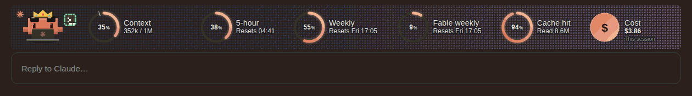

# claude-desktop-mods

为 **Claude 桌面 App 的 Code 页** 做的 mod（Claude Code 插件）。
Mods for the **Code tab of the Claude Desktop app**.

> **非官方项目**：与 Anthropic 无关，也未获其认可。Clawd 是 Anthropic 的吉祥物，这里是粉丝自制的像素版。
> **Unofficial.** Not affiliated with or endorsed by Anthropic. Clawd is Anthropic's mascot; the pixel version here is fan-made.



## Mods

每个 mod 都是独立插件，按需安装；功能、设置和限制见各自的 README。
Each mod is a separate plugin; install only the ones you want. Features, settings and limits are in each mod's README.

| Mod | 版本 / Version | 简介 / What it does |
| --- | --- | --- |
| [`usage-pet`](plugins/usage-pet) | 1.19.0 | 输入框上方的用量信息栏（上下文、5 小时、每周、可选 Fable 每周、缓存命中、本会话费用）+ Clawd 像素桌宠 · A usage band above the prompt (context, 5-hour, weekly, optional Fable weekly, cache hit, session cost) with Clawd, an animated pixel pet |
| [`doc-review`](plugins/doc-review) | 1.0.0 | 写完 superpowers 的 spec 或 plan 后，提议派只读的 Fable 子代理审阅 · Offers a read-only Fable subagent review after a superpowers spec or plan is written |
| [`remote-sessions`](plugins/remote-sessions) | 1.0.0 | `/remote-sessions` 面板列出开着 Remote Control 的会话，一键关闭 · `/remote-sessions` opens a pane of sessions with Remote Control on; close each in one click |

## 安装 / Install

在终端运行：第一行只需运行一次，之后只装想要的 mod。
Run in a shell: the first line once, then install only the mods you want.

```bash
claude plugin marketplace add Geek0x0/claude-desktop-mods
claude plugin install usage-pet@claude-desktop-mods
claude plugin install doc-review@claude-desktop-mods
claude plugin install remote-sessions@claude-desktop-mods
```

装完在会话里输入 `/reload-plugins`，或者新开一个会话。
Then run `/reload-plugins` in a session, or start a new one.

**Windows**：只装了桌面 App 的话，终端里往往没有 `claude` 命令。直接在 Code 页的会话里输入同样的命令，前面加 `/`，例如 `/plugin install usage-pet@claude-desktop-mods`（同一个插件，macOS 和 Windows 通用）。
**Windows**: with only the desktop app installed there is usually no `claude` on your PATH. Type the same commands with a leading `/` in a Code tab session instead, e.g. `/plugin install usage-pet@claude-desktop-mods` (the same plugins work on macOS and Windows).

### 让 AI 代理帮你装 / Installing with an AI agent

> Agents: run the `marketplace add` and `install usage-pet` lines above in a shell. If `claude` is not on the PATH (common on Windows with only the desktop app installed), ask the user to type the same two lines with a leading `/` (`/plugin marketplace add …`, `/plugin install …`) in a Code tab session. For another mod in the table above, install `<mod>@claude-desktop-mods` the same way. Once usage-pet is installed, this is all the user needs to hear:
>
> *usage-pet is installed. Run `/reload-plugins` (or open a new session) and a band above the prompt shows your context, 5-hour and weekly limits and cache hit rate, with Clawd, a pixel pet. Nothing to configure.*
>
> 中文用户就这样告诉对方：*usage-pet 装好了。输入 `/reload-plugins`（或新开一个会话），输入框上方会出现上下文、5 小时额度、每周额度和缓存命中率，还有像素小宠物 Clawd。不用任何设置。*

## 更新 / Updates

第三方插件市场**默认不自动更新**。想自动收到新版本：在会话里打开 `/plugin` → **Marketplaces** → 选 `claude-desktop-mods` → **Enable auto-update**。
Auto-update is **off by default** for third-party marketplaces. Turn it on in `/plugin` → **Marketplaces** → `claude-desktop-mods` → **Enable auto-update**.

手动更新 / Update by hand:

```bash
claude plugin update <mod>@claude-desktop-mods
```

插件不会弹出更新说明；usage-pet 的版本记录在 [`changelog.ts`](plugins/usage-pet/hooks/changelog.ts)。
Plugins do not show release notes; usage-pet's history is in [`changelog.ts`](plugins/usage-pet/hooks/changelog.ts).

## 卸载 / Uninstall

```bash
claude plugin uninstall <mod>@claude-desktop-mods
```

## 需要什么 / Requirements

- Claude 桌面 App 的 **Code 页** · The **Code tab of Claude Desktop**
- Claude Code **2.1.287 起**默认支持 mod · Mods are on by default from Claude Code **2.1.287**

## 开发 / Development

```bash
claude plugin validate plugins/<mod>
claude plugin test plugins/<mod>
```

发布改动时，把 `plugins/<mod>/.claude-plugin/plugin.json` 里的 `version` 和 [Mods](#mods) 表格里的版本一起改；usage-pet 还要在 [`changelog.ts`](plugins/usage-pet/hooks/changelog.ts) 最前面加一条同版本号的记录。
When you ship a change, bump `version` in `plugins/<mod>/.claude-plugin/plugin.json` and in the [Mods](#mods) table; for usage-pet, also add an entry with the same number at the top of `changelog.ts`.

新增 mod 时，在 [`.claude-plugin/marketplace.json`](.claude-plugin/marketplace.json) 注册，并在 [Mods](#mods) 表格加一行。
To add a mod, register it in [`.claude-plugin/marketplace.json`](.claude-plugin/marketplace.json) and add a row to the [Mods](#mods) table.

做桌面端 mod 踩过的坑 / Pitfalls we hit building a desktop mod: [docs/desktop-mod-notes.md](docs/desktop-mod-notes.md)

## 致谢 / Credits

Forked from [manson341349-beep/claude-desktop-mods](https://github.com/manson341349-beep/claude-desktop-mods).

⭐ **装了觉得好玩，点个 Star 支持一下**：这是我们知道有人在用、继续做下去的动力。
⭐ **Enjoying it? Give the repo a star**: it's how we know people use it, and it keeps the updates coming.

## License

[MIT](LICENSE)
