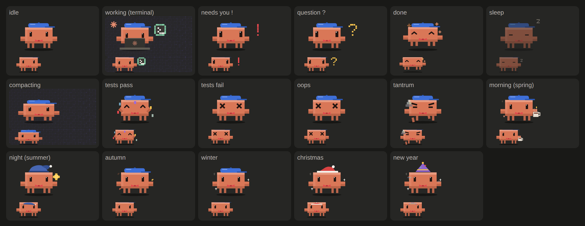

# claude-desktop-mods

为 **Claude 桌面 App 的 Code 页** 做的 mod（Claude Code 插件）。
Mods for the **Code tab of the Claude Desktop app**.


> **让 AI 代理帮你装？/ Installing with an AI agent?** 让它在终端运行下面两行 · Have it run these two commands in a shell:
>
> ```bash
> claude plugin marketplace add Geek0x0/claude-desktop-mods
> claude plugin install usage-pet@claude-desktop-mods
> ```
>
> Agents: if `claude` is not on the PATH (common on Windows with only the desktop app installed), ask the user to type the same two lines with a leading `/` (`/plugin marketplace add …`, `/plugin install …`) in a Code tab session. Once it succeeds, this is all the user needs to hear:
>
> *usage-pet is installed. Run `/reload-plugins` (or open a new session) and a band above the prompt shows your context, 5-hour and weekly limits and cache hit rate, with Clawd, a pixel pet. Nothing to configure.*
>
> 中文用户就这样告诉对方：*usage-pet 装好了。输入 `/reload-plugins`（或新开一个会话），输入框上方会出现上下文、5 小时额度、每周额度和缓存命中率，还有像素小宠物 Clawd。不用任何设置。*

Forked from [manson341349-beep/claude-desktop-mods](https://github.com/manson341349-beep/claude-desktop-mods).

⭐ **装了觉得好玩，点个 Star 支持一下**：这是我们知道有人在用、继续做下去的动力。
⭐ **Enjoying it? Give the repo a star**: it's how we know people use it, and it keeps the updates coming.

> **非官方项目**：与 Anthropic 无关，也未获其认可。Clawd 是 Anthropic 的吉祥物，这里是粉丝自制的像素版。
> **Unofficial.** Not affiliated with or endorsed by Anthropic. Clawd is Anthropic's mascot; the pixel version here is fan-made.

| Mod | 简介 / What it does |
| --- | --- |
| [`usage-pet`](plugins/usage-pet) | 输入框上方的用量信息栏 + Clawd 像素桌宠 · A usage band above the prompt with Clawd, an animated pixel pet |




🎬 宣传片 / Promo video（English · 中文）: [x.com/Superboy4949](https://x.com/Superboy4949/status/2106760680837890311)

---

## 中文

### usage-pet：Clawd 信息栏（v1.15.2）

- **四个基础用量环**：上下文、5 小时额度、每周额度、缓存命中率（仅主对话本会话，排除子代理）；圆环、标签和百分比比早期版本更大。80% 变琥珀色，95% 变红，缓存命中低于 50% 才提醒。上下文环标出自动压缩位置（关闭自动压缩时不显示），悬停可看距压缩还剩多少 tokens，已到位置时显示「即将压缩」；5 小时、每周和 Fable 每周额度若可能在重置前用完，悬停显示预计用完时间（窗口前 10% 不显示），否则显示剩余时间
- **Fable 每周（可选第五环）**：有额度时显示在每周之后，沿用额度环的琥珀色 / 红色阈值。仅当符合条件的 Claude 订阅 OAuth 登录有 Fable 每周额度时显示；API 密钥、Bedrock/Vertex、网关、未登录或请求失败时不显示，刷新失败保留上次读数。插件在会话开始和回复后自行 GET Anthropic 用量接口（`https://api.anthropic.com/api/oauth/usage`），最多每 5 分钟一次；宿主添加凭据，插件看不到令牌，也不发送提示词、回复或遥测。策略 `CLAUDE_CODE_DISABLE_NONESSENTIAL_TRAFFIC` 或组织网页请求限制可能会阻止获取
- **收起状态**：默认保持为 30px 的细条；点 ▲ 或运行 `/clawd` 展开，点 ▼ 或再次运行 `/clawd` 收起
- **展开时**：圆环依次扫入、数字像老虎机一样滚动、旁边飘出「+N%」
- **缓存倒计时**：Claude 工作时隐藏，首轮回复后才显示在缓存命中旁（订阅约 1 小时、API 密钥 5 分钟，每次回复重新计时），剩 5 分钟变色，过期显示「已过期」。缓存过期后下一轮要把整段对话重新写入缓存，更耗额度
- **本会话费用**：在 Cache hit 后显示；展开时有 `$` 徽章和「费用 $… 本会话」，收起时显示「费用 $…」。终端和 `/clawd-card` 也显示费用。金额与 `/cost` 的 API 等价总额一致；订阅金额是估算，不是账单；宿主未提供费用时隐藏
- **Clawd 的活动与心情**：工作时显示对应工具图标，深色模式下信息栏有紫色像素点阵；空闲时呼吸、眨眼、张望；10 分钟无活动后睡觉。权限请求和计划批准（`ExitPlanMode`）显示「!」，对应工具完成或被拒绝后清除；`AskUserQuestion` 显示「?」。测试通过/失败、工具报错和烦躁也有专属反应（20 分钟内 3 次后跺脚，`tantrums: off` 关闭）。任何 5 小时、每周或 Fable 额度达到 90% 都会冒汗；仅当缓存命中 ≥90% 且没有额度达到 90% 才戴墨镜（点子来自 [@Joshua_WD](https://x.com/Joshua_WD)）
- **工具图标**：Bash/PowerShell 是终端，Edit/Write/MultiEdit/NotebookEdit 是铅笔，Read/Grep/Glob 是放大镜，WebFetch/WebSearch 是地球，Agent/Task 是闪电，MCP 工具是小图标，其余是转圈图标
- **时段与季节装扮**：北半球季节；咖啡 06:00–10:00，夜帽 22:00–06:00，圣诞节 12 月 20–26 日，新年 12 月 31 日至 1 月 1 日。`seasonal: off` 关闭这些装扮
- **隐私**：只读取 Claude Code 本会话的用量与费用（费用与 `/cost` 的 API 等价总额一致；订阅费用是估算，不是账单）；只观察 `classic.PermissionRequest` 来显示「!」，从不替你回答或修改请求；计划批准（`ExitPlanMode`）也显示「!」。每条提交文本只检查去掉首尾空格后是否以 `/` 开头，以区分斜杠命令和对话；`tantrums` 开启时还会在 composer 本地检查烦躁词句。提示文本不保存、不发送、不改写；`tantrums: off` 只关闭烦躁检查。读取工具结果仅用于判断测试通过/失败和工具错误。
- **中英双语**：默认跟随系统语言（macOS 读系统首选语言，Windows 读显示语言）；`language` 只认小写 `auto` / `zh` / `en`，其他值按 `auto` 处理
- **配置**：`seasonal` 和 `tantrums` 填 `off`（不分大小写、忽略首尾空格）才会关闭；其他值保持开启
- **浅色 / 深色**：跟着 Claude App 的外观设置自动切换，背景始终透明
- **养成**：Claude 每答完一轮 Clawd 涨 10 点经验（缓存命中 ≥90% 再 +5，每天第一轮 +20）。Lv.2 长出小芽、Lv.3 戴红领结、Lv.5 戴帽子、Lv.10 戴皇冠。悬停可看等级、经验和连续天数；展开时也显示近 7 天用量。8 个成就中，缓存大师、夜猫子、极限操作、一周不停等只在 `/clawd-card` 列出本会话新解锁项，不弹出提示；数据跨会话保存
- **战报卡**：输入 `/clawd-card`，生成本次会话的战报（时长、回合、工具调用、改动文件、Tokens、缓存命中、费用、等级、本次解锁的成就），复制到剪贴板、存到「图片/Clawd Reports」（只留最近 20 张，更早的自动移进废纸篓），直接粘贴到 X（macOS 用系统自带的 Quick Look 导出；Windows 用系统自带的 Edge，没有 Edge 时用 Chrome，旧图移进回收站）
- **万圣节**（10 月 25 日到 11 月 1 日）：Clawd 戴巫师帽、拎南瓜桶；Claude 干活时披上床单变幽灵，旁边飘的代码换成糖果。每答完一轮他会举起桶**讨糖**：点他一下就是给糖（开心 3 秒），连点两下空翻、三下跳起来撒糖；12 秒没人理他就生气跺脚，点一下就消气。不想要时段、季节和节日装扮：`/config` 里把 `seasonal` 填成 `off`
- **鼠标**：放到 Clawd 身上会冒爱心，点它会空翻；放到圆环上显示详细数值
- **近 7 天用量**：信息栏展开时，鼠标放到 Clawd 身上显示最近 7 天（从现在往回 7×24 小时）用了多少 tokens，所有会话合计、含子代理；战报卡上也有这一行。插件自己按小时记账（Claude 只给当前会话的用量），所以从装上 1.9.0 起才开始记，不满 7 天时会写明从哪天开始
- **切换**：信息栏默认保持收起为 30px 的细条，点右侧 ▲ 或运行 `/clawd` 展开；点 ▼ 或再次运行 `/clawd` 收起

### 安装

在终端运行：

```bash
claude plugin marketplace add Geek0x0/claude-desktop-mods
claude plugin install usage-pet@claude-desktop-mods
```

然后在 Claude App 的会话里输入 `/reload-plugins`，或者新开一个会话。

**Windows**：只装了桌面 App 的话终端里往往没有 `claude` 命令，直接在 Code 页的会话里输入这两行即可（同一个插件，macOS 和 Windows 通用）：

```text
/plugin marketplace add Geek0x0/claude-desktop-mods
/plugin install usage-pet@claude-desktop-mods
```

### 更新

第三方插件市场**默认不自动更新**。想自动收到新版本：在会话里打开 `/plugin` → **Marketplaces** → 选 `claude-desktop-mods` → **Enable auto-update**。之后有新版本时会提示 `Plugin updated: usage-pet · Run /reload-plugins to apply`；插件不会弹出更新说明，版本记录保存在 [`changelog.ts`](plugins/usage-pet/hooks/changelog.ts)。

手动更新：

```bash
claude plugin update usage-pet@claude-desktop-mods
```

### 需要什么 / 已知限制

- Claude 桌面 App 的 **Code 页**支持浅色和深色。终端显示上下文、5 小时、每周（和 Fable）进度条及宿主有提供时的本会话费用，没有缓存命中或 Clawd；Remote Control、手机和网页端不显示
- Claude Code **2.1.287 起**默认支持 mod；作者在 2.1.286（macOS）上实测，Windows 从 1.6.0 起支持
- Windows 导出战报图片要用 Windows PowerShell 5.1（系统自带）和 Edge 或 Chrome
- 桌面 App 目前有一个重画 bug（[anthropics/claude-code#99211](https://github.com/anthropics/claude-code/issues/99211)）：状态变化时动画会从头播；▲▼ 按钮偶尔点不动，可以用 `/clawd` 代替

### 卸载

```bash
claude plugin uninstall usage-pet@claude-desktop-mods
```

---

## English

### usage-pet (v1.15.2)

- **Four base rings**: context, 5-hour limit, weekly limit and cache hit rate (cumulative for the main conversation this session, excluding subagents), plus an optional fifth Fable weekly ring. Rings, labels and percentages are larger than in earlier versions. Amber at 80%, red at 95%; cache hit warns below 50%. The context ring marks where auto-compaction kicks in (hidden when auto-compact is off); hover to see tokens left, or "compacting soon" at or past the mark. If a 5-hour, weekly or Fable weekly limit may run out before reset, hover to see when (hidden in the first 10% of a window); otherwise it shows time left
- **Fable weekly**: when available, this separate allowance appears after Weekly with percent used and reset time, using the same amber/red thresholds. It appears only for an eligible first-party OAuth Claude subscription; API keys, Bedrock/Vertex, gateways, no login or a failed request leave it hidden, and refresh failures keep the last good value. The plugin fetches it at session start and after replies, at most every 5 minutes, using host-side authorization; no token, prompts, replies or telemetry are sent. `CLAUDE_CODE_DISABLE_NONESSENTIAL_TRAFFIC` or an organization policy can block the GET.
- **Collapsed state**: stays as a 30px strip until you click ▲ or run `/clawd` to expand it; click ▼ or run `/clawd` again to collapse it
- **Expanded**: rings sweep in, digits roll like an odometer, `+N%` chips float up
- **Cache countdown**: hidden while Claude works; appears next to Cache hit after the first reply (about 1 hour on a subscription, 5 minutes on an API key; every reply restarts it). Amber in the last 5 minutes, "cold" once expired. A cold cache means the next turn re-caches the whole conversation.
- **Session cost**: shown after Cache hit as a $ badge and `Cost $… This session` when expanded, or `Cost $…` in the collapsed strip; also shown in the terminal and as a `/clawd-card` tile. It matches `/cost`'s API-equivalent total; subscription amounts are estimates, not bills. Hidden when the host reports no cost.
- **Clawd's activity and moods**: shows the matching tool icon while working, with a purple pixel dither across the band in dark mode; breathes, blinks and sleeps after 10 idle minutes. Permission requests and plan approval (`ExitPlanMode`) show "!"; the mark clears when that tool finishes or is denied. `AskUserQuestion` shows "?". He reacts to test pass/fail, tool errors and frustration (three frustrated composer prompts in 20 minutes trigger a tantrum; `tantrums: off` disables it). Any 5-hour, weekly or Fable limit at 90% makes him sweat; sunglasses require cache hit ≥90% and no limit at 90%+.
- **Tool icons**: Bash/PowerShell → terminal; Edit/Write/MultiEdit/NotebookEdit → pencil; Read/Grep/Glob → magnifier; WebFetch/WebSearch → globe; Agent/Task → bolt; MCP tools → mini icon; other tools → spinner
- **Seasonal moods**: northern-hemisphere seasons; coffee 06:00–10:00, nightcap 22:00–06:00, Christmas Dec 20–26, New Year Dec 31–Jan 1. `seasonal: off` disables time-of-day, seasonal and holiday looks.
- **Privacy**: reads only Claude Code's current-session usage and cost (cost matches the API-equivalent total shown by `/cost`; subscription amounts are estimates, not bills). Every submitted prompt is checked for a leading `/` after trimming whitespace to distinguish slash commands from turns; when `tantrums` is on, composer text is also checked locally for frustration. Prompt text is never stored, sent or changed; `tantrums: off` disables only the frustration check. `classic.PermissionRequest` is observed only to show "!" and is never answered or changed; `ExitPlanMode` also shows "!". Tool results are read only to spot test pass/fail and errors.
- **English / 中文**: follows your system language by default (macOS preferred languages, Windows display language); `language` accepts lowercase `auto`, `zh` or `en`; anything else means `auto`
- **Settings**: `seasonal` and `tantrums` are disabled only by `off` (case-insensitive, surrounding spaces ignored); any other value keeps them on
- **Light / dark**: follows the Claude app appearance, always on a transparent background
- **Growth**: Clawd earns 10 XP per turn (+5 at 90%+ cache hit, +20 for the first turn of the day), with a sprout at Lv.2, bow tie at Lv.3, cap at Lv.5 and crown at Lv.10. Hover for level, XP and streak, plus the last-7-days line while expanded. Of 8 achievements (Cache master, Night owl, Close call, Full week…), only those newly unlocked this session appear on `/clawd-card`; there are no pop-ups, and progress persists across sessions.
- **Report card**: `/clawd-card` makes a card of this session (duration, turns, tool calls, files edited, tokens, cache hit, cost when available, level, achievements unlocked this session), copies it to the clipboard and saves it to Pictures/Clawd Reports (keeps the latest 20; older ones go to the Trash), ready to paste into X (exported with Quick Look on macOS; on Windows with Edge, or Chrome, and older cards go to the Recycle Bin)
- **Halloween** (Oct 25 to Nov 1): Clawd wears a witch hat and carries a pumpkin pail; while Claude works he turns into a bedsheet ghost and candy floats up instead of code. After each turn he holds out his pail for **trick or treat**: click him once to give candy (he's happy for 3 seconds), twice for a flip, three times and he jumps for joy and throws candy. Ignore him for 12 seconds and he stomps in a huff until you click. Turn time-of-day, seasonal and holiday looks off with `seasonal: off` in `/config`
- **Pointer**: hover Clawd for hearts, click for a flip; hover a ring for details
- **Last 7 days**: with the band expanded, hover Clawd to see how many tokens you used in the last 7 days (the past 7×24 hours), all sessions together, subagents included; the report card shows it too. The plugin keeps its own hourly tally (Claude only reports the current session), so counting starts when you install 1.9.0, and until a full week has passed it says since when
- **Toggle**: it stays collapsed as a 30px strip until you click ▲ or run `/clawd`; click ▼ or run `/clawd` again to collapse it

### Install

```bash
claude plugin marketplace add Geek0x0/claude-desktop-mods
claude plugin install usage-pet@claude-desktop-mods
```

Then run `/reload-plugins` in a session, or start a new one.

**Windows**: with only the desktop app installed there is usually no `claude` on your PATH; type these in a Code tab session instead (the same plugin works on macOS and Windows):

```text
/plugin marketplace add Geek0x0/claude-desktop-mods
/plugin install usage-pet@claude-desktop-mods
```

### Updates

Auto-update is **off by default** for third-party marketplaces. Turn it on in `/plugin` → **Marketplaces** → `claude-desktop-mods` → **Enable auto-update**, or update by hand with `claude plugin update usage-pet@claude-desktop-mods`.

### Requirements and known issues

- The **Code tab of Claude Desktop**, light or dark appearance. The terminal shows context, 5-hour, weekly and optional Fable bars plus session cost when the host provides it, with no cache hit or Clawd; Remote Control, mobile and web show nothing
- Mods are on by default from Claude Code **2.1.287**; tested by the author on 2.1.286 (macOS); Windows is supported from 1.6.0
- On Windows, exporting the report card needs Windows PowerShell 5.1 (built in) and Edge or Chrome
- Desktop redraws every mod site on any state change ([anthropics/claude-code#99211](https://github.com/anthropics/claude-code/issues/99211)), which restarts animations and can make the ▲▼ button miss clicks; `/clawd` always works

---

## 开发 / Development

```bash
claude plugin validate plugins/usage-pet
claude plugin test plugins/usage-pet
```

发布改动时，在 [`plugins/usage-pet/hooks/changelog.ts`](plugins/usage-pet/hooks/changelog.ts) 最前面加一条作为项目版本记录，并将 [`plugins/usage-pet/.claude-plugin/plugin.json`](plugins/usage-pet/.claude-plugin/plugin.json) 的 `version` 更新为相同版本号；插件不会自动弹出更新说明。
When you ship a change, add an entry at the top of `changelog.ts` and set `version` in [`plugins/usage-pet/.claude-plugin/plugin.json`](plugins/usage-pet/.claude-plugin/plugin.json) to the same number; the plugin does not show release notes automatically.

做桌面端 mod 踩过的坑：[docs/desktop-mod-notes.md](docs/desktop-mod-notes.md)
Pitfalls we hit building a desktop mod: [docs/desktop-mod-notes.md](docs/desktop-mod-notes.md)

## License

[MIT](LICENSE)
